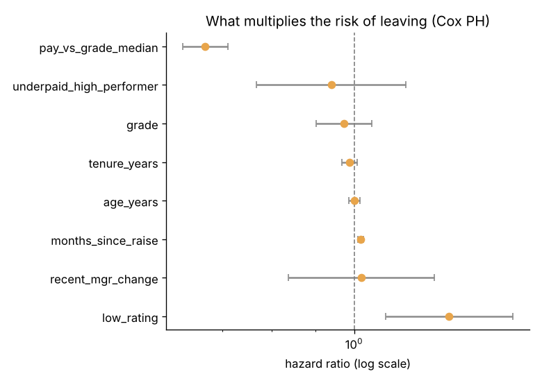

# Employee Attrition: Survival-First Risk Model

Answers two HR questions:
1. **What multiplies the risk of leaving, and by how much?** Answered by a **Cox proportional hazards** model (primary).
2. **Who should HR talk to this month?** Answered by an **XGBoost triage list** with SHAP reasons (secondary).

> **About the data.** This is a public re-implementation of an attrition model I built at a commercial bank. HR data is highly confidential and is **not** in this repo. The code runs on a synthetic HR system with hiring, appraisals, raises, promotions, manager changes and messy exit codes. The "In production" section describes the real project. Results after it come from the synthetic data.



## In production (the real project, Jul 2026)

| | |
|---|---|
| **Pipeline** | Oracle-compliant SQL built on the HR employee master, delivered as **five Oracle views** |
| **Target** | **Resignation + Withdrawal of Service + Termination** (binary attrition) |
| **Exclusions** | **Death** and **Duplicate Record** exits removed |
| **Retirement** | Handled **deterministically** (statutory age), not modelled |
| **Models** | **Cox PH** as the primary model, plus an **XGBoost classifier** for monthly HR triage with **SHAP** |

The target definition and the five-view structure are reproduced here exactly.

## Approach

| View | Purpose |
|---|---|
| `v1_employee_clean` | Removes duplicate records and deaths, flags the attrition event, derives the retirement date |
| `v2_survival_spells` | Employees in post on a **landmark date**, followed until exit, retirement (censored) or end of data |
| `v3_compensation` | Pay vs **grade median**, months since raise / promotion, 24-month pay growth |
| `v4_mobility` | Manager changes (12 months), department transfers (24 months) |
| `v5_performance` | Latest rating, rating change, high-performer flag |

Two landmark dates give an honest out-of-time test: **2024-06-30** for training (24 months of follow-up) and **2025-06-30** for testing.

## Results on the synthetic reproduction

**Cox PH:** concordance 0.688 on train and **0.712 out-of-time**.

| Factor | Hazard ratio | Reading |
|---|---|---|
| Pay vs grade median (per +10%) | **0.67** | Paying 10% more relative to the grade cuts the hazard by about a third |
| Low rating (≤ 2) | **1.29** | Managed exits plus disengagement |
| Months since last raise | **1.018 / month** | About 1.4× the hazard after 18 months without a raise |
| Underpaid high performer | 0.94 (n.s.) | Explained by the pay gap itself once pay is in the model |

**Monthly triage (exit within 6 months):** out-of-time AUC **0.731**. The top-50 list has **28% precision** against a 5.6% base rate (**5× lift**), and the top decile captures 25% of leavers.

## Run it

```bash
pip install -r requirements.txt
python run_pipeline.py
```

Or open `notebooks/walkthrough.ipynb`.

## Repo layout

```
data/generate_synthetic.py      month-by-month workforce simulation, 2019-2026
sql/views/v1..v5_*.sql          the five views (DuckDB / ANSI SQL)
sql/model_base.sql
src/features.py                 builds the views for a landmark date
src/models.py                   Cox PH + PH-assumption test, XGBoost triage
run_pipeline.py
notebooks/walkthrough.ipynb
```

## Author

**Oluwasemilore Sadare**, Senior Data Scientist · [LinkedIn](https://www.linkedin.com/in/oluwasemilore-sadare) · [GitHub](https://github.com/SMLRE)
